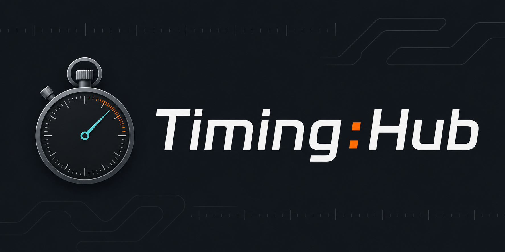

# Timing:Hub

<div align="center">



<br/><br/>

**Professional motorsport live-timing platform for classic events**

*ADAC • Badenpokal • Schauinsland Klassik • Käthchen Klassik*

[](https://www.typescriptlang.org/)
[](https://kit.svelte.dev/)
[](https://fastify.dev/)
[](https://go.dev/)
[](https://www.postgresql.org/)
[](https://redis.io/)
[](https://pnpm.io/)

[**timinghub.de**](https://timinghub.de) · [Issues](https://github.com/Labushuya/timing-hub/issues) · [Releases](https://github.com/Labushuya/timing-hub/releases)

---

| Bereich | Verzeichnis |
|---|---|
| 🌐 Landing Page | [`landing/`](./landing/) |
| 🖥️ Web App | [`apps/web/`](./apps/web/) |
| ⚡ API | [`apps/api/`](./apps/api/) |
| 🔌 Timing Bridge | [`apps/bridge/`](./apps/bridge/) |
| 📦 Shared Types | [`packages/shared-types/`](./packages/shared-types/) |
| 🏆 Scoring Engine | [`packages/scoring-engine/`](./packages/scoring-engine/) |

</div>

---

## What is Timing Hub?

Timing Hub replaces manual scoring sheets and Excel files at classic motorsport events with a browser-based real-time system. No installation required for anyone except the optional [Timy Bridge](#timy-bridge) for hardware timing devices.

### Who uses it?

| Role | What they do |
|---|---|
| **Veranstalter** (Organizer) | Creates events, configures participants & posts, exports results |
| **Zeitnehmer** (Marshal) | Enters times at their post via phone browser — or plugs in a Timy device |
| **Kommissar** (Chief Timekeeper) | Live overview of all posts, confirms/voids entries, exports final results |
| **Teilnehmer** (Participant) | Views their own times and the live leaderboard — no account needed |

### Motorsport formats supported

See [Supported Event Formats](#supported-event-formats) for details.

---

## Tech Stack

| Layer | Technology |
|---|---|
| Frontend | SvelteKit 2 + Svelte 5, Tailwind 4, PWA service worker |
| API | Fastify 5, TypeScript, Node.js 20 |
| Scoring engine | Pure TypeScript (shared package) |
| Database | PostgreSQL 16 + pgbouncer |
| Cache / queues | Redis 7 (pub/sub + BullMQ) |
| Timy Bridge | Go 1.23 (USB serial, cross-platform binary) |
| Dynamic DNS | DuckDNS (self-hosted deployments) |
| Monorepo | pnpm workspaces |

---

## Architecture

```
timinghub.de          (Vercel — SvelteKit SSR + PWA)
    │
api.timinghub.de      (Railway — Fastify 5 + Node.js)
    │
    ├── PostgreSQL 16  (Railway)
    ├── Redis 7        (Railway — pub/sub + BullMQ)
    └── Worker         (Railway — scoring recompute)

At the event venue:
  [ALGE Timy 3]        ──USB──────► [timing-bridge] ──WSS──► API
  [TAG Heuer CP-Serie] ──RS-232──► [timing-bridge] ──WSS──► API
  [Trentmann RallyStar]──RS-232──► [timing-bridge] ──WSS──► API
```

### Monorepo structure

```
timing-hub/
├── apps/
│   ├── web/        # SvelteKit 2 + Svelte 5 + Tailwind 4
│   ├── api/        # Fastify 5 + TypeScript
│   └── bridge/     # Go 1.23 binary (Timy USB bridge)
├── packages/
│   ├── shared-types/     # TypeScript interfaces
│   └── scoring-engine/   # Pure TS scoring logic (GLP/SP/Rundstrecke/Orientierung)
└── infra/
    └── docker-compose.dev.yml
```

---

## Dokumentation

| Dokument | Beschreibung |
|---|---|
| [Betriebsanleitung](docs/betriebsanleitung.md) | Vollständige Anleitung für Veranstalter, Zeitnehmer und Kommissare |
| [Self-Hosting (Raspberry Pi)](docs/self-hosting-raspberry-pi.md) | Schritt-für-Schritt Setup auf eigenem Server |

---

## Timy Bridge

The only non-browser component. A single executable (~14 MB, no installer) that:

1. Connects to ALGE Timy 3 via USB, or TAG Heuer CP / Trentmann RallyStar via RS-232/USB-Serial
2. Streams timing impulses to the cloud via WebSocket
3. Buffers locally (SQLite WAL) when offline — resumes on reconnect
4. Shows a tray icon (green = connected, red = device missing)

See [`apps/bridge/BRIDGE.md`](apps/bridge/BRIDGE.md) for device configuration, COM port detection, and troubleshooting.

**Download from [Releases](https://github.com/Labushuya/timing-hub/releases):**
- `timy-bridge-windows-amd64.exe`
- `timy-bridge-darwin-arm64`
- `timy-bridge-linux-amd64`

---

## Getting Started (Development)

### Prerequisites

- Node.js 20+
- pnpm 9+
- Docker (for local Postgres + Redis)
- Go 1.23+ (bridge only)

### Setup

```bash
git clone https://github.com/Labushuya/timing-hub.git
cd timing-hub

# Install dependencies
pnpm install

# Start local database + Redis
docker compose -f infra/docker-compose.dev.yml up -d

# Copy env file and configure
cp .env.example .env

# Run database migrations
pnpm --filter @timing-hub/api migrate

# Seed test data (creates admin user + test registration token)
pnpm seed

# Start everything in parallel
pnpm dev
```

App is available at:
- **Frontend:** http://localhost:5173
- **API:** http://localhost:3001
- **API health:** http://localhost:3001/health

### First-time admin setup

The first admin account is bootstrapped via `MASTER_ADMIN_TOKEN` in `.env`.
Use it to call `POST /v1/admin/tokens` to generate registration tokens for Veranstalter accounts.

---

## Development

```bash
pnpm typecheck    # TypeScript check (all packages)
pnpm test         # Run unit tests
pnpm lint         # ESLint + Prettier check
pnpm build        # Production build (all packages)
```

### Bridge (Go)

```bash
cd apps/bridge
go build -o timy-bridge .
./timy-bridge --config bridge.toml
```

The bridge exposes a local status API at `http://localhost:7272/status`.

---

## Deployment

| Service | Platform | Notes |
|---|---|---|
| Frontend | Vercel | Auto-deploy on push to `main` |
| API | Railway | 2 replicas, auto-scale |
| Worker | Railway | BullMQ scoring jobs |
| PostgreSQL | Railway | Postgres 16 + pgbouncer |
| Redis | Railway | Pub/Sub + BullMQ queues |
| DNS | Cloudflare | timinghub.de + api.timinghub.de |
| DNS (self-hosted) | DuckDNS | Dynamic DNS for Raspberry Pi setup |

Required secrets in Railway/Vercel:
`DATABASE_URL` · `REDIS_URL` · `JWT_SECRET` · `MASTER_ADMIN_TOKEN` · `CORS_ORIGIN` · `SENTRY_DSN` (optional)

---

## Roadmap

- [x] Phase 0 — Monorepo foundation, shared types, scoring engine
- [x] Phase 1 — Auth, admin token system, event/participant/posten CRUD
- [x] Phase 2 — WebSocket hub, live timing, scoring integration, dashboards
- [x] Phase 3 — Timy Bridge Go binary (ALGE Timy 3, USB protocol, cross-platform release)
- [x] Phase 4 — PWA service worker, i18n (DE/EN), PDF export, bundle optimization
- [x] Phase 5 — E2E tests, security hardening, monitoring, production config
- [x] Self-hosting — Raspberry Pi 5 setup with DuckDNS + Nginx + Docker Compose
- [x] Domain-knowledge corrections — correct GLP scoring (absolute timestamps → section deltas)
- [x] TAG Heuer CP-Serie — Bridge support for CP 450 / 500 / 520 / 525 / 540 (RS-232/USB-serial)
- [x] Trentmann RallyStar — Bridge support (serial protocol)
- [ ] Klassen-Modi — configurable class definition criteria (Baujahr, Hubraum, Kategorie, kombiniert)
- [ ] Monetarisierung — Stripe-Integration für Event-Token / Veranstalter-Abonnement

---

## Supported Hardware

| Gerät | Verbindung | Status |
|---|---|---|
| **ALGE Timy 3** | USB (VID 0x0c4a / PID 0x0889) | ✅ Unterstützt |
| **TAG Heuer CP 450 / 500 / 520 / 525 / 540** | RS-232 / USB-Serial | ✅ Unterstützt |
| **Trentmann RallyStar** | RS-232 / USB-Serial | ✅ Unterstützt |
| **Manuelle Eingabe** | Browser | ✅ Immer verfügbar |
| **CSV / Excel Import** | Datei-Upload | ✅ Immer verfügbar |

---


| Format | Scoring logic |
|---|---|
| **GLP** (Gleichmäßigkeitsprüfung) | Sollzeit-Abweichung ergibt Strafpunkte; Sektions-Sollzeiten möglich. Wertung basiert auf delta zwischen Sektions-Timestamps — nicht auf absoluten Zeiten. |
| **Sonderprüfung** | Schnellste Gesamtzeit gewinnt; Sektoren werden aufaddiert. |
| **Rundstrecke** | Rundenzeiten, Bestzeit und Rückstand auf Führenden werden live berechnet. |
| **Orientierungsfahrt** | Sektionen mit konfigurierbarer Früh- und Spät-Strafe (Sekunden pro Abweichungssekunde). |

---

## License

Private — all rights reserved. Contact the maintainer for licensing inquiries.
